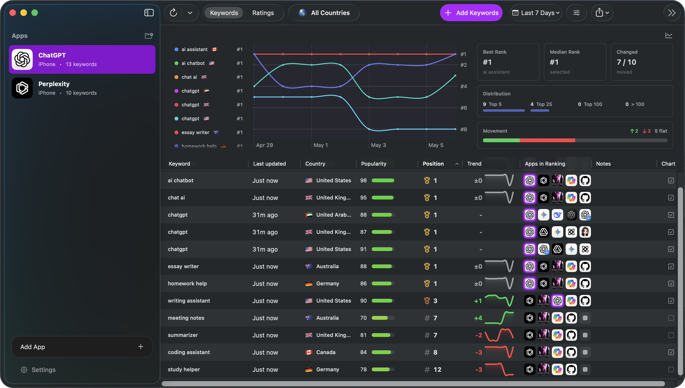

# OpenASO

OpenASO is a native macOS app for App Store Optimization research. It helps track App Store keyword rankings, storefront ratings and reviews, competitor visibility, and Apple Ads keyword popularity for the apps you monitor.



## What OpenASO Does

- Track App Store apps by storefront, App Store ID, bundle ID, title, seller, and platform.
- Create keyword tracks across countries and record ranking snapshots over time.
- Inspect ranked competitor apps returned for each keyword search.
- Monitor storefront ratings, rating history, and reviews.
- Import keyword lists and export keyword, keyword history, and rating data as CSV.
- Run manual refreshes or configure an automatic daily refresh for stale ranking data.

## Documentation

The hosted docs are the canonical guide for using OpenASO:

- [Quickstart](https://openaso.thirdtechapps.com/docs/getting-started/quickstart/)
- [Core concepts](https://openaso.thirdtechapps.com/docs/getting-started/concepts/)
- [Manage apps](https://openaso.thirdtechapps.com/docs/guides/manage-apps/)
- [Track keywords](https://openaso.thirdtechapps.com/docs/guides/track-keywords/)
- [Ratings and reviews](https://openaso.thirdtechapps.com/docs/guides/ratings-reviews/)
- [Apple Ads](https://openaso.thirdtechapps.com/docs/guides/apple-ads/)
- [Import and export](https://openaso.thirdtechapps.com/docs/guides/import-export/)
- [Daily refresh](https://openaso.thirdtechapps.com/docs/guides/daily-refresh/)
- [CSV formats](https://openaso.thirdtechapps.com/docs/reference/csv-formats/)
- [Common issues](https://openaso.thirdtechapps.com/docs/troubleshooting/common-issues/)

## Requirements

- macOS 15.0 or later
- Xcode 17 or later with Swift 6.2 support
- Apple Ads and App Store Connect credentials for private account-backed features

## Setup

1. Clone the repository.
2. Open `OpenASO.xcodeproj` in Xcode, or build from the command line.
3. Use `.env.example` as a reference if you want to export Apple Ads API credentials as process environment variables.
4. Connect Apple Ads from the app Settings window. Sign-in opens in a WebKit window inside OpenASO, so 2FA and passkeys behave like they do in Safari. If you would rather sign in with the browser you already use, expand "Sign In With My Own Browser" and paste the cookie header from an Apple Ads page.
5. Enter App Store Connect credentials in the app Settings window when needed.

Anonymous analytics are enabled by default and can be disabled at any time in Settings. OpenASO uses anonymous product usage events to understand which features are used and how often; it does not collect identifying information or details about your apps, keywords, reviews, replies, credentials, search text, or countries.

## Data And Credentials

OpenASO stores app, keyword, rating, review, and metric data locally with SwiftData. CSV export is the primary path for using that data outside the app, especially for AI-assisted review analysis, keyword research, reporting, or spreadsheets.

### MCP Keyword Suggestions

The `suggest_keywords` tool automatically queries Apple's official keyword suggestion API when saved Apple Ads API credentials are available. It combines those candidates with app metadata and optional website text, then checks a bounded sample against live App Store rankings. Without API access, or when an Apple request fails, metadata and website suggestions remain available; `providerErrors` reports failed Apple requests separately from ranking errors.

Pass `seed_keyword` to explore a specific topic, for example:

```json
{
  "appStoreID": 123456789,
  "storefronts": ["us"],
  "seed_keyword": "speech to text",
  "limit": 20
}
```

The `appleAdsSuggestions` array includes the returned keyword, contextual `suggestionScore`, requested storefront, seed, observation time, and `isTracked`. Each suggestion also carries a fresh `popularity` lookup when available, with its market score, source, time, and unavailability reason. Suggestions are ordered by market popularity before contextual score. Contextual scores can change with the seed and remain separate from market `popularityScore`. Apple does not return a country on each suggestion, so the requested storefront is not a guarantee of the contextual score's geographic scope.

For broader discovery, use `limit: 50` and `ranking_limit: 0`, try distinct feature seeds, then branch using relevant terms with market popularity above 5. Follow `suggestionPages.nextOffset` with the same seed/limit to explore more results. `get_keyword_popularity` checks up to 50 untracked or tracked terms in three storefronts without adding tracks or persisting metrics; it uses the official API and saved web-session fallback. Missing popularity is unknown, not zero, and popularity is an index rather than exact search volume. Stop at a request budget or when successive branches stop producing useful new terms, and report remaining gaps.

Discovery queries cover at most three storefronts per call, with at most 50 suggestions per page and offsets through 1000. Ranking verification defaults to 16 checks and can return partial results; use `get_ranked_apps_for_keyword` to verify a shortlist after expansion. `metadataSeeds` remains available when ranking checks are skipped or API credentials are unavailable. Discovery does not add tracks. Select relevant terms and call `add_keywords` to track them, which skips duplicates. Then use `refresh_keyword_metrics` with an optional `keywords` filter (at most 50 terms) to save their market popularity without refreshing every tracked term. The [ASO skill](.agents/skills/openaso-aso/SKILL.md) documents the full research workflow.

### MCP Metadata Targeting

Saved App Store Connect credentials support `get_app_store_metadata`, which reads an exact locale from live or editable metadata, including private keywords and version/state. Apple Ads credentials supply separate popularity evidence. Metadata reads fail on missing locales or ambiguous app-info state instead of mixing languages or versions.

Pass a discovery shortlist to `audit_keyword_targeting` to compare fresh popularity, app-specific relevance, field coverage and bounded ranking evidence. At most 50 keywords and eight ranking checks are supported; ranking checks default to five and can be skipped with `ranking_limit: 0`. Literal phrases, word combinations, plural variants and missing components remain distinct. Relevance uses the app's metadata rather than hard-coded app-blocker terms; overlap and popularity are evidence for review, not guaranteed opportunities.

Use `compare_metadata_draft` for agent-written title/subtitle/keyword alternatives. It validates 30/30/100 character limits, highlights duplicate/filler terms, reports gained/lost coverage and accepts `expected_hash` to reject a stale baseline. All metadata reads, audits and draft comparisons leave App Store fields unchanged.

`record_metadata_baseline` stores a private local snapshot before a metadata release. `list_metadata_baselines` locates it and `compare_metadata_baseline` compares the same keyword/market/platform set after the release. Rank deltas require known native positions in both samples; fallback and absent ranks remain unknown. Optional search impressions/downloads have caller-provided provenance and reporting periods, with no per-keyword attribution or causal lift claim. No tool publishes metadata or schedules a follow-up.

See the [metadata targeting workflow](.agents/skills/openaso-aso/references/metadata-targeting.md) for sequencing and evidence requirements.

### Recovering A Local Database

If OpenASO cannot open its local database, it does not delete or replace the existing files and shows the database location when available. Before attempting recovery:

1. Quit every running OpenASO app and MCP process.
2. Copy the entire `SwiftData` directory to a safe location. Keep `default.store`, `default.store-wal`, and `default.store-shm` together; do not delete or restore an individual file.
3. Restore the complete directory from a compatible backup, or open it with the compatible OpenASO version that created it.
4. Reopen OpenASO only after the complete directory is back in place.

Keep the backup until the restored database has opened and its contents have been verified. OpenASO does not automatically reset or replace a database that fails to open.

## Build And Test

Build and run:

```sh
./script/build_and_run.sh
```

Run tests:

```sh
xcodebuild test -project OpenASO.xcodeproj -scheme OpenASO -destination 'platform=macOS,arch=arm64' -derivedDataPath Build CODE_SIGNING_ALLOWED=NO
```

Launch smoke check:

```sh
./script/build_and_run.sh --verify
```

## Apple Service Notes

OpenASO relies on public App Store endpoints, Apple Ads APIs, App Store Connect APIs, and an optional browser-backed Apple Ads session helper. These services may rate-limit, redirect, require two-factor authentication, or change response formats. The app reports provider errors where possible, but some features require valid account access and current Apple service behavior.

## License

OpenASO is available under the MIT License. See `LICENSE`.
